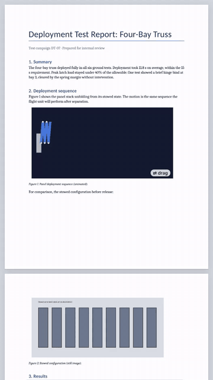

# 3DF Converters

Turn a Google Docs report with GIFs into one file that opens on any phone or computer, offline, and still moves.



Built on [3DF](https://github.com/mfogelson/3df), the open-source document format created by Mitchell Fogelson (MIT license). The format, its specification and the original tools are his; this repository adds converters, exports and tests around it.

## What this adds

- **Google Docs and Word to 3DF** (`docx2_3df.py`): keeps the page layout and searchable text, and lays each GIF back over its spot so it plays. Handles cropped, resized and transparent GIFs, header logos and landscape pages.
- **A page with no code inside** (`3df2html.py`): one `.html` file that opens offline in any browser or phone preview. GIFs play; GIFs marked `[drag]` in their alt text can be stepped through by hand; 3D models turn and tilt.
- **PDF and ebook versions** (`pdf3df.py`, `3df2epub.py`): a real PDF that opens everywhere with still images and carries the `.3df` inside, and an EPUB where GIFs play in Apple Books.
- **Convert without installing anything**: upload a `.docx` to [`inbox`](inbox) on GitHub and the results appear in [`outbox`](outbox) a couple of minutes later.
- **Safety and tests**: size limits and image checks before export, and 41 automated checks, including hostile inputs.

## Status

Working prototype. Tested on real Google Docs exports, iPhone (Safari and Files preview), and Chrome with JavaScript disabled. Not yet tested on Firefox, Android, or LibreOffice versions other than 24.2. Anything that can't move falls back to a still image, so files always open.

---

# The 3DF format
 
3DF (`.3df`) is a fixed-layout document format, like PDF, that also supports animated images and interactive 3D models (glTF). See [SPEC.md](SPEC.md).
 

 
*`sample.3df` in the viewer. The GIF plays on its own; the truss turns here for the demo, and in the viewer you drag to rotate it.*
 
## Contents
 
| File | Purpose |
|---|---|
| `SPEC.md` | Format specification, v0.1 |
| `threedf.py` | Pack, unpack and validate `.3df` files |
| `pptx2_3df.py` | Convert PowerPoint (`.pptx`) decks to `.3df`. For Google Slides, download as `.pptx` first |
| `convert_inbox.py` | Converts every Word file in `inbox/` into `outbox/<name>/`; run by the GitHub workflow on upload |
| `docx2_3df.py` | Convert Word or Google Docs (`.docx`) reports to `.3df`; GIFs keep playing and the text stays searchable |
| `export_html.py` | Package any `.3df` as one `.html` that opens offline in any browser, and extract the `.3df` back out |
| `pdf3df.py` | Ship a `.3df` inside an ordinary PDF that opens everywhere; extract it back; check files. See [docs/PDF-PROFILE.md](docs/PDF-PROFILE.md) |
| `3df2html.py` | Convert a `.3df` to one `.html` with **no JavaScript**: GIFs still play, GIFs marked `scrub` can be dragged through by hand, and 3D models become figures you turn (drag sideways) and tilt (drag up or down), all with CSS scroll-driven animations, it opens offline in any browser and in previews that block scripts, and prints with stills |
| `render_views.py` | Pre-render a glTF model from 36 directions at 4 heights with the viewer's own three.js camera and lighting (headless Chromium via Playwright) |
| `3df2epub.py` | Convert a `.3df` to a fixed-layout EPUB 3, so readers people already have play its GIFs: Apple Books (iPhone, iPad, Mac), Google Play Books (Android). Passes EPUBCheck |
| `reader_template.html`, `build_reader.py` | Offline PDF reader (PDF.js) that plays 3DF content inside any PDF |
| `viewer_template.html` | Browser viewer; `build_viewer.py` embeds a sample document into it |
| `vendor/` | Viewer libraries inlined by the HTML tools: JSZip and three.js r128 (MIT), PDF.js 3.11 (Apache 2.0), with their licenses |
| `make_sample.py`, `make_test_deck.py`, `make_test_report.py` | Generate the sample document and converter test files |
| `make_readme_gif.py` | Render `docs/sample.gif`, the animated preview above |
 
## Quick start
 
```
pip install -r requirements.txt
python make_sample.py                     # builds sample.3df
python threedf.py validate sample.3df
python pptx2_3df.py deck.pptx             # needs LibreOffice installed
python build_viewer.py                    # writes viewer.html with sample.3df embedded
python docx2_3df.py report.docx           # Google Docs: File > Download > .docx; needs LibreOffice
python export_html.py export report.3df   # report.3df.html: send it, it opens offline anywhere
python docx2_3df.py report.docx report.3df --pdf report.print.pdf
python pdf3df.py wrap report.3df report.pdf --print report.print.pdf   # a real PDF/A-3 with the .3df inside
python build_reader.py report.pdf        # reader.html plays it; any other PDF reader shows stills
python 3df2epub.py report.3df            # report.epub: GIFs play in Apple Books and Google Play Books
python 3df2html.py report.3df            # report.html: no scripts, GIFs play in any browser or preview
```

## Converting without installing anything

Upload a Word file (.docx) to the [`inbox`](inbox) folder on github.com (**Add file → Upload files**). A GitHub Actions workflow converts it on GitHub's computers, and a folder with the `.html`, `.pdf`, `.epub` and `.3df` versions appears in [`outbox`](outbox) a few minutes later, with a `REPORT.md` listing any warnings. Progress shows on the **Actions** tab. To do the same on your own computer: `python convert_inbox.py`.

## Dragging instead of looping

Start a GIF's alt text with `[drag]` in Word or Google Docs and `docx2_3df.py` marks it `"scrub": true`. In `3df2html.py` output, swiping sideways across that figure steps through its frames, so a turntable GIF becomes a model you turn by hand and a deployment GIF one you unfold yourself. It needs no script. Readers that don't know `scrub` just play the GIF. This is a proposed field, not yet in SPEC v0.1.

## Turning 3D models without a script

`3df2html.py` renders each 3D model with `render_views.py` (144 views, about 1–1.5 MB as WebP) and lays them out so that dragging sideways turns the model and dragging up or down tilts it. It's one axis of turning plus four camera heights, not free rotation or zoom; the live viewer from `export_html.py` still does that. Use `--no-views` to show the model's still instead.

## Sending a .3df to someone

No phone or browser opens `.3df` files yet, so `export_html.py export` wraps the document and a viewer into one `.html` file. It makes no network requests, and three.js is only included when the document has 3D models. The original `.3df` sits untouched inside a `<script type="application/vnd.3df+zip" id="threedf-document">` block, so `export_html.py extract` gets back the identical file.
 
Open `viewer.html` in a browser and use **Open .3df** to view any document.
 
## License
 
MIT. See [LICENSE](LICENSE). The specification in `SPEC.md` is covered by the same license, so anyone may implement readers and writers for 3DF.

